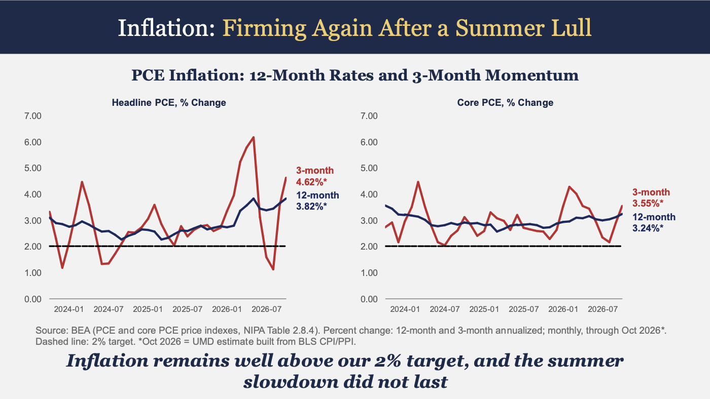
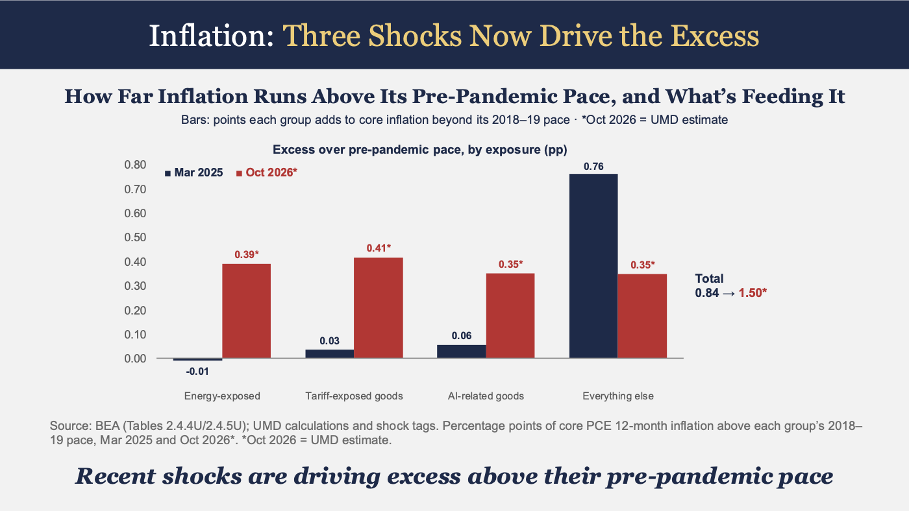
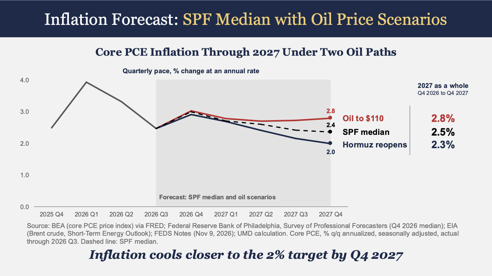
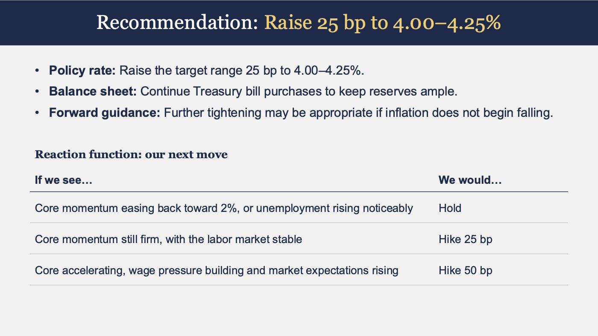

# College Fed Challenge 2026: Inflation Analysis (University of Maryland)

**3rd place nationally** at the 2026 College Fed Challenge, behind the University of Chicago and UCLA. A record 141 schools entered; 7 reached the national finals at the Federal Reserve Board in Washington, D.C. (Nov 20, 2026).

The College Fed Challenge asks undergraduate teams to act as the FOMC: assess the economy, forecast it, and recommend monetary policy, then defend the case in live Q&A with Federal Reserve officials. This repository holds the finals research behind the team's **inflation section**, built by Eli Powers, along with the data pipelines, the forecast, and the AI-assisted research and audit workflow used to produce them.

**The recommendation:** raise the federal funds target range 25 bp to 4.00–4.25%, with a stated reaction function for holding or hiking further.

| | |
|---|---|
|  |  |
|  |  |

Full deck: [`01_Finals/slides/College_Fed_Challenge_Finals.pdf`](01_Finals/slides/College_Fed_Challenge_Finals.pdf). The deck is the whole team's; this repository documents the inflation section (slides 4–10), the inflation forecast (slide 21) and the r* comparison (slide 22).

## The inflation case

The section follows one chain: **evidence → interpretation → mechanism → forecast → policy consequence → revision trigger**.

1. **Level and momentum.** Core PCE inflation was 3.24% over 12 months and 3.55% over 3 months (annualized) in October 2026. October is a UMD estimate built from BLS CPI and PPI, made before BEA's release.
2. **Breadth.** 59% of core spending had prices rising faster than 3% (149-component core PCE, excluding hospitals).
3. **Drivers.** Core inflation's excess over its 2018–19 pace rose from 0.84 to 1.50 pp between March 2025 and October 2026. The three tagged shocks (energy, tariffs and the AI buildout) went from 0.08 to 1.15 pp of it, while everything else fell from 0.76 to 0.35 pp.
4. **AI buildout prices.** Producer prices for AI hardware inputs are rising at a record pace.
5. **Second-round effects.** Oil and tariff costs show up in exposed prices, but not yet in unit labor costs or wages.
6. **Persistence risk.** Household 1-year expectations are 3.9%, and the net share of small firms planning price increases is 37.
7. **Distribution.** Inflation for the bottom 40% of households runs 0.22 pp above overall CPI, and for the top 20% it runs 0.37 pp below (NY Fed Economic Heterogeneity Indicators).
8. **Forecast.** Core PCE, Q4 2026 to Q4 2027: 2.5% (SPF median), 2.8% with oil at $110, 2.3% if the Strait of Hormuz reopens. The oil scenarios use the response estimated in a November 2026 FEDS Note.
9. **Policy stance.** The real policy rate (1.20%) sits at the low end of published r* estimates (1.01–1.85%).

## How this was built

Eli directed the research, made the judgment calls and verified the work. **Coding agents wrote most of the code and first-draft analysis:** Claude (Anthropic) as coordinator and subagents, Codex (OpenAI) as an independent auditor. The workflow:

1. **Brief.** Each research question becomes a subtask in `02_Research/Subtasks/NN_name/` with a written brief: the question, the deliverable and the evidence rules (primary sources, saved raw files, scripted numbers, every claim tagged by how it was verified).
2. **Research.** Claude runs subagents on the brief, then checks their load-bearing numbers and quotes against primary sources before writing `report.md`.
3. **Independent audit.** Codex audits the report against the raw data and sources on its own copies of the files, and writes findings by type and severity. Claude accepts, rejects with evidence, or escalates. Rounds continue until no blocking findings remain (3 rounds at most).
4. **Judgment calls go to Eli.** Framing, interpretation and policy calls are never settled between the models. Both positions go to Eli, who decides.

The instructions that define this are public:

| File | Role |
|---|---|
| [`CLAUDE.md`](CLAUDE.md) | Claude's instructions as a research assistant: modes, evidence standard, research workflow |
| [`AGENTS.md`](AGENTS.md) | Codex's instructions as independent auditor: scope, file boundaries, findings format |
| [`.claude/skills/coordinate`](.claude/skills/coordinate/SKILL.md) | How a subtask is split, briefed, run and verified |
| [`.claude/skills/audit-loop`](.claude/skills/audit-loop/SKILL.md) | Claude's side of the audit loop |
| [`.agents/skills/audit`](.agents/skills/audit/SKILL.md) | Codex's audit procedure |

**Two worked audit loops:**
- [`06_Audits/00_audit_test`](06_Audits/00_audit_test/): a test of the loop with an error planted on purpose. Codex caught it.
- [`06_Audits/slide3b_build`](06_Audits/slide3b_build/): the forecast slide. Codex independently reproduced every plotted value. Its working files are in [`99_Codex/slide3b_build`](99_Codex/slide3b_build/).

## Repository map

| Folder | Contents |
|---|---|
| `01_Finals/` | Final deck (PDF), slide data workbooks, slide build instructions |
| `02_Research/Subtasks/` | One folder per research question: brief, notes, sources, report, `code/` |
| `03_Data/pipelines/` | Recurring data pipelines (inflation indicators, price baskets, demand signals, the forecast). See [`03_Data/README.md`](03_Data/README.md) |
| `03_Data/Raw/` | One-off raw downloads (not committed; see below) |
| `06_Audits/`, `99_Codex/` | The two audit case studies |
| `docs/img/` | Slide images used in this README |

## Reproducing results

Every reported number traces to a saved raw file and a script.

```bash
pip install -r requirements.txt
cp .env.example .env   # add free FRED, BLS and BEA API keys
python3 -I 03_Data/pipelines/forecast_3b/code/forecast.py --spf 2026Q4
python3 -I 03_Data/pipelines/forecast_3b/tests/test_zero_gap.py --spf 2026Q4
```

- Run all scripts from the repository root.
- **Raw downloads are not committed** (about 0.8 GB). The fetch scripts in each pipeline's `code/` and each subtask's `code/` re-download them. Publishers revise data, so a fresh download may differ from the vintage used here. Some scripts pull exact past vintages from ALFRED.
- Processed outputs are committed, so results can be checked without re-downloading.
- [`03_Data/README.md`](03_Data/README.md) maps each data release to the scripts to run.

## Notes on this snapshot

- This is a curated copy of the working project, frozen after the finals. Round 1 work (the October submission and semifinal) is not included. Some finals pipelines grew out of it.
- Some files mention material that isn't in this repository: a project state file (`STATE.md`), an archive (`07_Archive/`), idea and learning logs (`04_Ideas/`, `05_Learning/`), and the speaker script and Q&A prep. They are left as written, as an honest record of the process.
- Draft decks, slide render checks and Codex's local working copies are not included, so some build notes and Codex's `audit_check.py` point to files that aren't here.
- The published slide workbooks in `01_Finals/data/` leave out one tab (judgment calls and paywalled sources) that the build scripts still create.
- Dates in briefs and notes refer to the working timeline (Oct–Nov 2026).

## Credits

Team: David Sorensen, Eli Powers, Chinedu Akunna, Jake Foreman and Sara Videnovic. Faculty adviser: Luminita Stevens. Thanks to Professor S. Borağan Aruoba for guidance during preparation.

## License

Code: [MIT](LICENSE). Text, slides and figures: [CC BY 4.0](LICENSE-text.md). Data remain subject to their publishers' terms.
